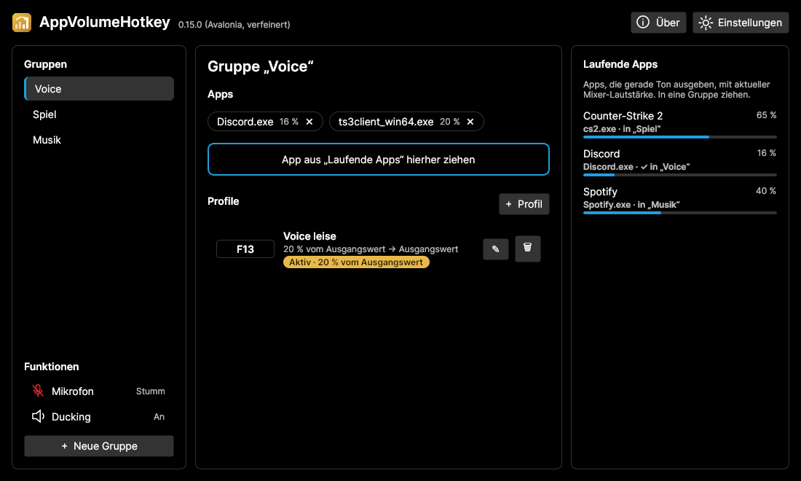
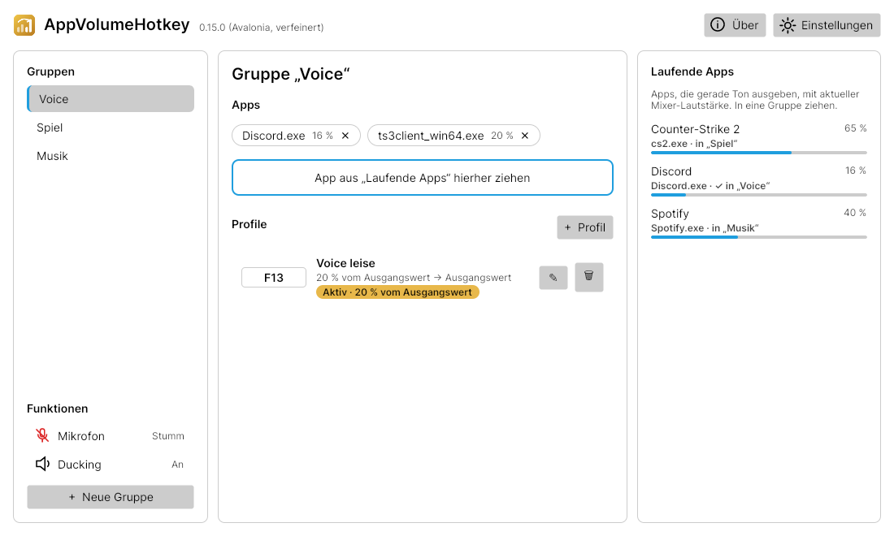

# Konzept: Linux-Version mit Avalonia

Stand: 2026-11-09 · Status: **Idee, nicht beauftragt** – „vielleicht später“.

## Ziel

AppVolumeHotkey zusätzlich unter Linux anbieten, mit **einer gemeinsamen Oberfläche** für Windows und Linux (Weg B), statt zwei getrennter Oberflächen.

## Ausgangslage (v0.14.3)

| Teil | Umfang | Linux |
|---|---|---|
| Kernlogik `AppVolumeHotkey.Core` (Gruppen, Profile, Toggle/Halten, Ausgangswerte, Mikrofon-Modi, Ducking, Texte DE/EN) | ~1.650 Zeilen + 96 Tests | läuft unverändert |
| Oberfläche (WPF: Fenster, Dialoge, Overlay, Statusanzeige) | ~3.500 Zeilen | nach Avalonia übertragen – XAML sehr ähnlich, Stile/Steuerelemente anpassen |
| Windows-Schnittstellen (Core Audio, Mikrofon, RegisterHotKey, Maus-Hook, Tray, Autostart, Einzelinstanz, Admin) | ~2.000 Zeilen | pro Plattform neu, gleiches Prinzip |

## Entscheidungen / Erkenntnisse

- **Oberfläche:** Avalonia (MIT, Open Source). Einzige Fremdbibliothek; wird im Über-Fenster mit Lizenz aufgeführt. .NET bringt unter Linux keine eigene Oberfläche mit – ohne Avalonia (oder ein anderes Toolkit) geht es nicht.
- **Microsoft Store** bleibt möglich: Avalonia-Apps sind unter Windows normale Desktop-Apps; MSIX-Build wie bisher.
- **Schrift:** Windows → Segoe UI; Linux → Systemschrift des Desktops (Segoe darf nicht mitgeliefert werden, Inter nicht nötig).
- **Symbole:** eigene Vektorgrafiken statt Segoe Fluent Icons (lizenzfrei, auf beiden Systemen gleich).
- **App-Erkennung:** Windows über `.exe`-Namen, Linux über den Namen der Programmdatei (z. B. `Discord`, `ts3client_linux_amd64`). Gruppen sind daher nicht 1:1 zwischen den Systemen übertragbar.

## Linux-Bausteine

| Funktion | Weg |
|---|---|
| Lautstärke pro App, Pegel (Ducking) | PipeWire über die PulseAudio-Schnittstelle (`sink-input` pro App, Monitor-Streams für Pegel) |
| Mikrofon stumm | Aufnahmegerät (`source`) stummschalten |
| Globale Hotkeys inkl. Maustasten | X11: `XGrabKey`/`XGrabButton`; Wayland: nur über das GlobalShortcuts-Portal (eingeschränkt, Maustasten fraglich) |
| Tray | StatusNotifierItem (Avalonia `TrayIcon`) |
| Overlay/Statusanzeige | X11: transparentes, klick-durchlässiges Fenster; Wayland: stark eingeschränkt |
| Autostart | `~/.config/autostart/*.desktop` |
| Einzelinstanz | Datei-Lock oder Unix-Socket |
| Auslieferung | AppImage und/oder `.deb` aus dem GitHub-Build, später evtl. Flathub |

Testumgebung des Nutzers: Linux Mint 22.3, Cinnamon, **X11**, PipeWire 1.0.5 – alle Bausteine dort machbar.

## Prototyp

Wegwerf-Prototyp des Hauptfensters (nur Optik, keine Logik), auf Linux Mint gerendert:

| Dunkel | Hell |
|---|---|
|  |  |

XAML: [`prototype-MainWindow.axaml`](prototype-MainWindow.axaml) (Avalonia 11.2.3, Fluent-Theme mit Anpassungen: Listen ohne Hintergrund, runde Einträge mit Akzentstrich, eigene Vektor-Symbole).

## Grobe Reihenfolge, falls es losgeht

1. Oberfläche nach Avalonia umziehen (zuerst Windows), WPF-Projekt ersetzen; Snapshot-Tests/Bilder weiterführen.
2. Plattform-Schnittstellen hinter Interfaces ziehen (Audio, Mikrofon, Hotkeys, Tray, Autostart, Einzelinstanz).
3. Linux-Implementierungen (PulseAudio/PipeWire, X11), auf dem Laptop des Nutzers testen.
4. Linux-Pakete im GitHub-Build (AppImage/.deb).

## Offene Fragen

- Wayland-Unterstützung nötig oder X11 ausreichend?
- Wie wichtig ist „keine Fremdbibliotheken“ gegenüber der Linux-Version?
